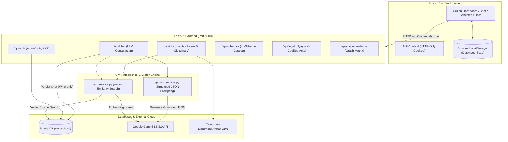
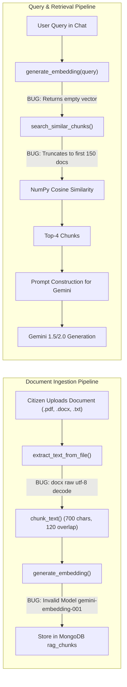
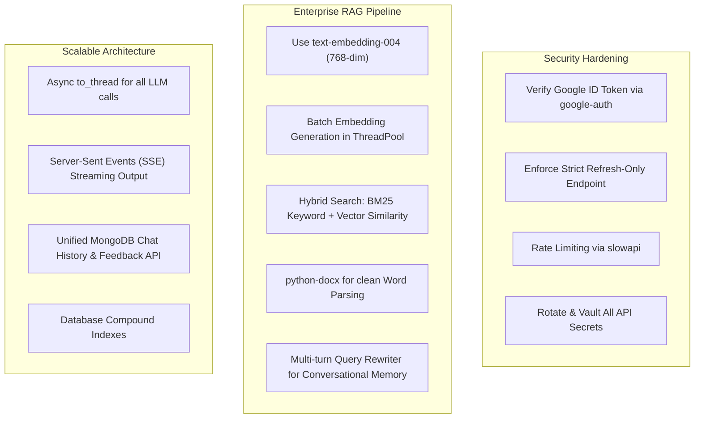

# CivicSphere AI: Comprehensive Technical, Security & RAG Pipeline Audit Report

> **Project:** CivicSphere AI — Evidence-Grounded Civic & Legal Intelligence Platform  
> **Repository Target:** Civicsphere  
> **Date of Audit:** November 13, 2026  
> **Assessment Scope:** Full Full-Stack Codebase Audit (FastAPI Backend, React/Vite Frontend, RAG Pipeline, MongoDB Schemas, Authentication & Session Security, Cloudinary CDN, External APIs)

---

## 1. Executive Summary & Overall Architecture

CivicSphere is designed as a citizen-centric platform providing statutory legal guidance, welfare scheme discovery, document analysis, and conversational AI grounded in Indian law (NeGD Nyaykosh, India Code, myScheme, API Setu).

While the user interface design and feature breadth are commendable, our in-depth static analysis and runtime tracing revealed **critical security vulnerabilities**, **fatal flaws in the RAG embedding pipeline**, **blocking asynchronous operations**, and **severe data desynchronization between MongoDB and browser `localStorage`**.

### Current System Health Scorecard

| Category | Score | Primary Reason |
| :--- | :---: | :--- |
| **Security & Authentication** | 🔴 **Critical (35/100)** | Unverified Google OAuth allows total account takeover; raw secrets exposed in `.env`; refresh token misuse. |
| **RAG Pipeline & Embeddings** | 🔴 **Broken (20/100)** | Invalid embedding model names cause complete failure; synchronous blocking loops during chunking/seeding; corrupt DOCX parsing. |
| **Backend API & Routes** | 🟡 **Needs Work (58/100)** | Missing chat history endpoints (write-only black hole); unhandled OOM risks; duplicate exception blocks. |
| **Frontend & UI Logic** | 🟡 **Moderate (72/100)** | Clean UI components, but critical form logic bugs (PM Kisan criteria mislabeling); chat file attachment is a no-op; state mutation during render. |
| **Scalability & Performance** | 🟡 **Fair (50/100)** | In-memory 150-chunk vector truncation; blocking event loop calls on heavy LLM inference; lack of SSE streaming. |

---

### System Architecture Data Flow



---

## 2. Security Vulnerabilities & Lapses (Ranked by Severity)

### 🔴 Finding SEC-01: Critical Authentication Bypass & Account Takeover via Google OAuth
* **Location:** `server/app/routers/auth.py` (lines 224-260) and `client/src/components/common/GoogleSignInButton.jsx`
* **Severity:** **CRITICAL (CVSS 9.8)**
* **Mechanism:**
  The endpoint `POST /api/auth/google` accepts a JSON payload conforming to `GoogleAuthRequest`. The backend inspects `req.email` and directly fetches or creates the user, subsequently issuing signed JWT authentication cookies (`access_token` and `refresh_token`):
  ```python
  @router.post("/google", response_model=AuthResponse)
  async def google_auth(req: GoogleAuthRequest, response: Response):
      if not req.email:
          raise HTTPException(...)
      email = req.email.strip().lower()
      user = await get_user_by_email(email)
      if not user:
          # Creates account...
      _set_auth_cookies(response, user["id"], remember_me=True)
      return AuthResponse(...)
  ```
  **The `req.credential` parameter (Google ID Token) is NEVER verified with Google public keys (`google-auth`)!**
  Furthermore, the frontend fallback button invokes `window.prompt("Enter your Google Account email address to continue:")` and passes that raw string directly to the backend.
* **Exploitation:**
  Any unauthenticated attacker can execute:
  ```bash
  curl -X POST http://localhost:8000/api/auth/google \
       -H "Content-Type: application/json" \
       -d '{"email": "admin@civicsphere.gov"}' \
       -c cookies.txt
  ```
  The server responds with `200 OK` and issues valid administrator session cookies, allowing total account takeover without knowing any password or token.
* **Remediation:**
  Enforce cryptographic validation of Google ID tokens using `google.oauth2.id_token.verify_oauth2_token` with the server's `GOOGLE_CLIENT_ID`.

---

### 🔴 Finding SEC-02: Hardcoded Production Secrets in `.env`
* **Location:** `server/.env` and `server/app/config.py` (lines 13-16)
* **Severity:** **CRITICAL**
* **Mechanism:**
  The `server/.env` file contains plaintext, live secrets:
  - `GEMINI_API_KEY`: Active Google Gemini API key.
  - `CLOUDINARY_API_KEY` & `CLOUDINARY_API_SECRET`: Complete Cloudinary CDN management credentials.
  - `JWT_SECRET_KEY`: Static string (`civicsphere_super_secret_jwt_key_2026_evidence_grounded_ai_platform`).
  In `server/app/config.py`, this secret key is even hardcoded as the default fallback if the variable is missing. Anyone who reads the code can forge valid JWT tokens for any citizen ID.
* **Remediation:**
  1. Revoke and rotate the Gemini API key and Cloudinary secret immediately.
  2. Require `JWT_SECRET_KEY` to be passed as an environment variable and fail server startup if missing or set to a known default.
  3. Provide a sanitized `.env.example` file without real keys.

---

### 🟠 Finding SEC-03: Refresh Token Privilege Escalation & Revocation Bypass
* **Location:** `server/app/dependencies.py` (lines 20-27)
* **Severity:** **HIGH**
* **Mechanism:**
  In `get_current_user`:
  ```python
  if not payload or payload.get("type") != "access":
      refresh_token = request.cookies.get(settings.REFRESH_COOKIE_NAME)
      if refresh_token:
          r_payload = decode_token(refresh_token)
          if r_payload and r_payload.get("type") == "refresh":
              payload = r_payload
  ```
  If an access token is expired or absent, the dependency automatically treats the long-lived (7 days) refresh token cookie as a valid access token for *any* protected endpoint.
  This completely defeats access token expiry and eliminates the security barrier of short-lived tokens. If an attacker acquires the refresh cookie, they can perform actions directly indefinitely. Furthermore, there is no database session check or token blacklist to revoke compromised refresh tokens.
* **Remediation:**
  Strictly reject refresh tokens on standard endpoints. Only the dedicated `/api/auth/refresh` route should accept `refresh_token`.

---

### 🟠 Finding SEC-04: Unrestricted File Upload & Denial of Service (OOM)
* **Location:** `server/app/routers/documents.py` (lines 68-76)
* **Severity:** **HIGH**
* **Mechanism:**
  The document summarizer reads uploaded files entirely into RAM without checking file size:
  ```python
  contents = await file.read()
  ```
  An attacker can stream multiple 1GB–5GB payloads simultaneously. Because FastAPI loads the payload into memory, the server will crash with an Out-Of-Memory (OOM) error, creating an easy Denial of Service.
* **Remediation:**
  Enforce a maximum stream threshold (e.g. 20MB) by chunk-reading `file` and aborting with HTTP 413 (Payload Too Large) if exceeded.

---

### 🟡 Finding SEC-05: Avatar Upload Fallback Stored XSS / Database Bloat
* **Location:** `server/app/routers/auth.py` (lines 304-315)
* **Severity:** **MEDIUM**
* **Mechanism:**
  When Cloudinary is unconfigured or encounters an error, the backend base64-encodes the raw uploaded file and stores it directly into MongoDB as `avatar_url = f"data:image/{ext};base64,{b64}"`.
  1. No MIME-type or image header verification is performed (e.g., verifying PNG/JPEG magic numbers). An uploaded SVG file containing `<script>` tags stored in MongoDB will execute script when viewed.
  2. Storing 5MB base64 strings directly inside user MongoDB documents causes document fragmentation and memory bloat.
* **Remediation:**
  Validate file magic bytes using `PIL.Image` or `python-magic`, reject non-raster formats (allow only PNG, JPEG, WEBP), and store images as files or reject upload when CDN is unavailable.

---

### 🟡 Finding SEC-06: Permissive Cookie Flags in Development Mode
* **Location:** `server/.env` (lines 8-10) and `server/app/routers/auth.py` (lines 48-69)
* **Severity:** **MEDIUM**
* **Mechanism:**
  `COOKIE_SECURE=False` is hardcoded in `.env`. If deployed to staging or production over HTTPS, tokens will be transmitted in cleartext over unencrypted channels if an accidental HTTP request occurs.
* **Remediation:**
  Default `COOKIE_SECURE` to `True` when `ENVIRONMENT != "development"`.

---

## 3. RAG Pipeline In-Depth Audit

The RAG pipeline implemented in `server/app/services/rag_service.py` is a core selling point of the CivicSphere platform. However, our audit revealed several structural bugs preventing it from functioning reliably.



### Critical RAG Flaws Identified

#### 1. Non-Existent Embedding Model Names
* **Location:** `server/app/services/rag_service.py` (line 12)
* **Problem:**
  ```python
  EMBEDDING_MODELS = ["gemini-embedding-001", "gemini-embedding-2"]
  ```
  In Google GenAI API (`google-genai`), the models are named `text-embedding-004` (768 dimensions) or `models/text-embedding-004`. Models named `gemini-embedding-001` or `gemini-embedding-2` do not exist.
* **Impact:** Every call to `client.models.embed_content(...)` throws an HTTP 404 / NotFound error. The fallback loop exhausts all candidates and logs:
  `ERROR: Failed to generate embedding with all candidate models.`
  Because `generate_embedding()` returns `[]`:
  - `index_document_chunks()` inserts **0 chunks** into `db.rag_chunks`.
  - `search_similar_chunks()` immediately returns `[]`.
  - Auto-seeding of canonical statutes on startup silently fails.
  **The entire RAG vector pipeline is dead on arrival.**

#### 2. Event Loop Starvation During Startup Seeding & Ingestion
* **Location:** `server/app/services/rag_service.py` (lines 99-101) & `server/main.py` (lines 12-18)
* **Problem:**
  `generate_embedding()` is a synchronous, blocking network call.
  In `index_document_chunks()`, it is invoked inside an `async def` in a serial loop:
  ```python
  for idx, chunk in enumerate(chunks):
      embedding = generate_embedding(chunk) # Synchronous blocking call!
  ```
  During startup, `seed_canonical_statutes_for_rag` attempts to embed hundreds of chunks across 6 acts serially on the main thread, freezing the FastAPI event loop for 40–90 seconds.

#### 3. Unscalable In-Memory Vector Search with Arbitrary Truncation
* **Location:** `server/app/services/rag_service.py` (lines 151-155)
* **Problem:**
  ```python
  cursor = db.rag_chunks.find(query_filter, {"_id": 0, "embedding": 1, ...})
  candidates = await cursor.to_list(150)
  ```
  The server fetches up to 150 documents across MongoDB wire protocol, pulls their 768-dim float arrays into Python memory, and runs a manual NumPy dot product loop.
  - If a user uploads documents that push total chunks beyond 150, MongoDB returns an arbitrary first 150 records; chunks #151 onwards are **permanently invisible** to search.
  - Transferring megabytes of raw vectors per user query introduces severe latency under concurrent usage.

#### 4. Corrupt Text Extraction for DOCX Files
* **Location:** `server/app/routers/documents.py` (lines 42-49)
* **Problem:**
  DOCX files are compressed zip archives containing XML files. The parser does:
  ```python
  text = contents.decode("utf-8", errors="ignore")
  ```
  This extracts raw binary zip headers and garbled XML strings (`PK\x03\x04... [Content_Types].xml...`), which are then tokenized and embedded into RAG chunks, polluting the vector store with junk tokens.

#### 5. Chat File Attachment Is a Phantom Feature in UI
* **Location:** `client/src/pages/Chat.jsx` (lines 263-270)
* **Problem:**
  When a citizen selects a document via the Paperclip icon, `Chat.jsx` simply prefixes the text input with `[Referenced Document: filename.pdf]`.
  The file is **never uploaded, never parsed, and never passed to `documentContext`**. The backend never receives the file content.

#### 6. Zero Multi-Turn Conversation Memory
* **Location:** `server/app/routers/chat.py` (lines 48-53)
* **Problem:**
  `send_chat_message` passes only the single `req.message` to Gemini. None of the prior chat history is included. If a user asks "What is PM Kisan?" and follows up with "What are its benefits?", Gemini receives only "What are its benefits?" with zero contextual reference.

---

## 4. Backend Routes & Database Audit

### Route-by-Route Findings

| Route | Method | Issues Identified |
| :--- | :---: | :--- |
| `/api/auth/register` | `POST` | Password complexity check absent (only checks `len >= 6`). |
| `/api/auth/login` | `POST` | No rate limiting; vulnerable to brute-force credential stuffing. |
| `/api/auth/logout` | `POST` | Functional. Clears cookies. |
| `/api/auth/me` | `GET` | Functional. Refreshes session cookies. |
| `/api/auth/refresh` | `POST` | Functional, but lack of token blacklist allows revoked sessions to refresh. |
| `/api/auth/google` | `POST` | 🔴 **CRITICAL**: No Google ID token signature verification (SEC-01). |
| `/api/auth/profile` | `PUT` | Functional. Sanitizes output. |
| `/api/auth/avatar` | `POST` | 🟡 Overwrites `name` and `phone` with empty strings if not present in `current_user` (`auth.py` lines 311-314); potential stored XSS fallback. |
| `/api/auth/change-password` | `POST` | Functional. Verifies current password with Argon2. |
| `/api/chat/message` | `POST` | Duplicate `except` block in code (`chat.py` line 80); no multi-turn context; synchronous RAG chunk lookup. |
| `/api/chat/history` | `GET` | 🔴 **MISSING**: Backend stores history in MongoDB `chat_history`, but exposes **NO** API to fetch or delete user chat history! |
| `/api/documents/summarize` | `POST` | 🟠 No file size limit; corrupt DOCX extraction; synchronous chunk embedding blocks event loop. |
| `/api/documents` | `GET` | Functional. Returns user's uploaded documents. |
| `/api/documents/{doc_id}` | `DELETE` | Returns 200 even if `doc_id` does not exist (no 404 check). |
| `/api/schemes` | `GET` | Functional. Filters by category, state, query. |
| `/api/schemes/{id}` | `GET` | Functional. Returns single scheme. |
| `/api/schemes/check-eligibility` | `POST` | Functional logic, but frontend question mapping is inverted. |
| `/api/schemes/{id}/bookmark` | `POST` | Functional. Toggles saved scheme in MongoDB. |
| `/api/schemes/saved` | `GET` | 🟡 **MISSING**: No endpoint to list user's bookmarked schemes; client forced to use localStorage. |
| `/api/legal/nyaykosh` | `GET` | Functional. Returns codified acts. |
| `/api/legal/topics` | `GET` | Functional. Returns legal guidance topics. |
| `/api/legal/query` | `POST` | 🟡 Synchronous `generate_civic_guidance` call blocks FastAPI event loop (`legal.py` line 175). |
| `/api/civic-knowledge/graph`| `GET` | Functional. Returns nodes and links. |
| `/api/feedback` | `POST` | 🔴 **MISSING**: No backend endpoint exists; feedback is saved only in browser `localStorage`. |

---

### Database Indexes & Performance Audit
* In `server/app/database.py` (line 28), only `users.email` has an index created:
  ```python
  await db.users.create_index("email", unique=True)
  ```
* **Missing Essential Indexes:**
  - `rag_chunks`: Missing compound index on `{"user_id": 1, "doc_id": 1}`. Every RAG search performs a full collection scan across all chunks in the database!
  - `documents`: Missing index on `{"user_id": 1, "created_at": -1}`.
  - `chat_history`: Missing index on `{"user_id": 1, "chat_id": 1}`.
  - `saved_schemes`: Missing unique compound index on `{"user_id": 1, "scheme_id": 1}`. Currently, rapid double-clicks can create duplicate bookmarks.

---

## 5. Frontend Runtime Errors, Logic Bugs & UI Glitches

### 1. Form Logic Inversion in Scheme Eligibility Checker
* **Location:** `client/src/pages/GovernmentSchemes.jsx` (lines 468-499)
* **Bug:**
  Question 3 reads:
  > *"3. Do you have an active Aadhaar-linked bank account?"*
  The radio input modifies:
  ```javascript
  setEligibilityAnswer({ ...eligibilityAnswer, landholder: "yes" })
  ```
  On the backend, `myscheme_service.py` evaluates `landholder` as whether the citizen owns **agricultural land** for PM Kisan Samman Nidhi!
  Citizens who answer "Yes, I have an Aadhaar-linked bank account" are wrongly evaluated as possessing agricultural land.

### 2. Chat History Desynchronization (Database vs. LocalStorage)
* **Location:** `client/src/services/chatService.js` (lines 6-41)
* **Bug:**
  The frontend stores all chat messages in `localStorage` (`civicsphere_recent_chats` and `civicsphere_conversations`).
  If a citizen accesses the platform from another device, or logs out and clears browser storage, their entire conversation history disappears, even though MongoDB was saving every message in `db.chat_history`.

### 3. State Mutation During Render in `ProfileSettings.jsx`
* **Location:** `client/src/pages/ProfileSettings.jsx` (lines 34-45)
* **Bug:**
  ```javascript
  const [prevUser, setPrevUser] = useState(user);
  if (user !== prevUser) {
    setPrevUser(user);
    if (user) {
      setProfileData({ ... });
    }
  }
  ```
  Calling `setPrevUser` directly in the component render body triggers React warnings and causes unnecessary extra re-renders. This must be handled inside `useEffect`.

### 4. Dead Anchor Links in Chat Citations
* **Location:** `client/src/components/chat/ChatMessage.jsx` (lines 175-193)
* **Bug:**
  When RAG chunks originate from user documents, `gemini_service.py` outputs `link: "#"`.
  Clicking the citation in the chat UI scrolls the user to the top of the browser page rather than opening a preview or doing nothing.

### 5. Mocked Password Reset & Feedback Submissions
* **Location:** `client/src/pages/ForgotPassword.jsx` (lines 22-27) & `client/src/services/schemeService.js` (lines 92-130)
* **Bug:**
  Both features are purely client-side simulations. Reset links are never dispatched, and citizen feedback is dropped upon browser cache clearing.

---

## 6. Actionable Blueprint: How to Make CivicSphere Secure & Powerful



### Strategic Recommendations

1. **Implement Server-Sent Events (SSE) Streaming for LLM Responses:**
   Currently, users wait 4–10 seconds looking at bouncing dots while Gemini computes and formats the entire response. Switching to streaming (`client.models.generate_content_stream`) will render responses word-by-word instantly.
2. **Implement Hybrid Search (BM25 + Dense Vectors):**
   Indian statutes are heavy on specific terminology ("Section 318 BNS", "Zero FIR"). Pure vector cosine similarity often misses exact section numbers. Combining a MongoDB Text Index with Vector Cosine Similarity (Reciprocal Rank Fusion) delivers vastly superior accuracy.
3. **Multi-Turn Context Rewriting:**
   When a user submits a follow-up query, pass the last 3 exchanges into Gemini to formulate a stand-alone search query before retrieving RAG chunks.
4. **Cloudinary / Local GridFS Fallback:**
   Store document binaries in MongoDB GridFS when Cloudinary keys are not provided so users can always download their uploaded files.

---

## 7. Concrete Code Patches & Fixes

### Patch 1: Fix RAG Model Names & Async Non-Blocking Seeding
* **Target File:** `server/app/services/rag_service.py`

```python
# Replace lines 12-44 with valid model and batch handling:
EMBEDDING_MODELS = ["text-embedding-004"]

def generate_embedding(text: str) -> list[float]:
    """Generates a 768-dimensional vector embedding using Google text-embedding-004."""
    client = get_embedding_client()
    if not client or not text.strip():
        return []

    clean_text = text.replace("\n", " ").strip()[:2048]
    for model_name in EMBEDDING_MODELS:
        try:
            res = client.models.embed_content(
                model=model_name,
                contents=clean_text
            )
            if hasattr(res, "embedding") and res.embedding:
                return res.embedding.values
            if hasattr(res, "embeddings") and res.embeddings:
                return res.embeddings[0].values
        except Exception as e:
            logger.warning(f"Error generating embedding with {model_name}: {e}")
            continue
    return []
```

And in `index_document_chunks`:
```python
# Run embedding in thread to avoid blocking event loop
embedding = await asyncio.to_thread(generate_embedding, chunk)
```

---

### Patch 2: Patch Google OAuth Account Takeover Vulnerability
* **Target File:** `server/app/routers/auth.py`

```python
from google.oauth2 import id_token
from google.auth.transport import requests as google_requests

@router.post("/google", response_model=AuthResponse)
async def google_auth(req: GoogleAuthRequest, response: Response):
    """
    Secure Google OAuth endpoint.
    Strictly verifies the Google ID Token (credential) using Google Public Keys.
    """
    if not req.credential:
        raise HTTPException(
            status_code=status.HTTP_400_BAD_REQUEST,
            detail="Google ID token (credential) is required."
        )

    try:
        # Verify cryptographic signature of token
        id_info = id_token.verify_oauth2_token(
            req.credential,
            google_requests.Request(),
            settings.GOOGLE_CLIENT_ID
        )
        email = id_info.get("email", "").lower().strip()
        name = id_info.get("name", email.split("@")[0])
        avatar = id_info.get("picture", "")
    except Exception as e:
        raise HTTPException(
            status_code=status.HTTP_401_UNAUTHORIZED,
            detail=f"Invalid Google ID token: {str(e)}"
        )

    if not email:
        raise HTTPException(status_code=400, detail="Invalid token: email not present.")

    user = await get_user_by_email(email)
    if not user:
        random_pw = hash_password(uuid.uuid4().hex + "CivicSphereSecure2026!")
        user_id = "usr_g_" + uuid.uuid4().hex[:10]
        user = await create_user(
            user_id=user_id,
            name=name,
            email=email,
            hashed_password=random_pw,
            avatar=avatar
        )

    _set_auth_cookies(response, user["id"], remember_me=True)
    user_dict = dict(user)
    user_dict.pop("hashed_password", None)

    return AuthResponse(
        status="success",
        message="Google authentication successful.",
        user=UserResponse(**user_dict)
    )
```

---

### Patch 3: Fix Scheme Eligibility Criteria Radio Binding
* **Target File:** `client/src/pages/GovernmentSchemes.jsx` (lines 468-498)

```jsx
<div>
  <label className="block text-xs font-bold text-[#17212B] mb-1">
    3. Do you or your family own cultivable agricultural land?
  </label>
  <div className="flex gap-4 text-xs">
    <label className="flex items-center gap-1.5 cursor-pointer">
      <input
        type="radio"
        name="landholder"
        value="yes"
        checked={eligibilityAnswer.landholder === "yes"}
        onChange={() =>
          setEligibilityAnswer({ ...eligibilityAnswer, landholder: "yes" })
        }
        className="text-[#15965B]"
      />
      <span>Yes, landholder farmer</span>
    </label>
    <label className="flex items-center gap-1.5 cursor-pointer">
      <input
        type="radio"
        name="landholder"
        value="no"
        checked={eligibilityAnswer.landholder === "no"}
        onChange={() =>
          setEligibilityAnswer({ ...eligibilityAnswer, landholder: "no" })
        }
        className="text-[#15965B]"
      />
      <span>No (Landless / Non-Agricultural)</span>
    </label>
  </div>
</div>
```

---

### Patch 4: Fix DOCX Parsing in Document Ingestion
* **Target File:** `server/app/routers/documents.py` (lines 20-51)

```python
import io
import math
from docx import Document

def extract_text_from_file(filename: str, contents: bytes) -> tuple[str, int]:
    ext = filename.split(".")[-1].lower() if "." in filename else ""
    text = ""
    pages = 1

    if ext == "pdf":
        try:
            reader = PdfReader(io.BytesIO(contents))
            pages = max(1, len(reader.pages))
            page_texts = [page.extract_text() or "" for page in reader.pages]
            text = "\n\n".join(page_texts).strip()
        except Exception as e:
            text = f"PDF Document: {filename}"
    elif ext == "docx":
        try:
            doc = Document(io.BytesIO(contents))
            paragraphs = [p.text for p in doc.paragraphs if p.text.strip()]
            text = "\n\n".join(paragraphs).strip()
            pages = max(1, math.ceil(len(text) / 2500))
        except Exception as e:
            text = f"DOCX Document: {filename}"
    elif ext in ("txt", "md", "csv"):
        text = contents.decode("utf-8", errors="ignore")
        pages = max(1, math.ceil(len(text) / 2500))
    else:
        text = contents.decode("utf-8", errors="ignore")

    return text or f"Document: {filename}", pages
```

---

### Patch 5: Add Missing Database Indexes
* **Target File:** `server/app/database.py` (lines 27-30)

```python
async def init_db():
    print(f"[INFO] Connecting to MongoDB at {settings.MONGODB_URL}...")
    mongo.client = AsyncIOMotorClient(settings.MONGODB_URL, serverSelectionTimeoutMS=5000)
    db = get_database()
    
    await mongo.client.admin.command('ping')
    print(f"[INFO] Successfully connected to MongoDB database: '{settings.MONGODB_DB_NAME}'")
    
    # Indexes
    await db.users.create_index("email", unique=True)
    await db.rag_chunks.create_index([("user_id", 1), ("doc_id", 1)])
    await db.documents.create_index([("user_id", 1), ("created_at", -1)])
    await db.chat_history.create_index([("user_id", 1), ("chat_id", 1), ("created_at", -1)])
    await db.saved_schemes.create_index([("user_id", 1), ("scheme_id", 1)], unique=True)
    print("[INFO] MongoDB collections & indexes initialized.")
```

---

## 8. Summary Checklist of Next Steps

- [ ] **Rotate Exposed Keys:** Invalidate the Gemini and Cloudinary credentials currently in `.env`.
- [ ] **Install Verified Dependencies:** In server venv, run `pip install google-genai python-docx google-auth`.
- [ ] **Apply RAG Patch:** Update embedding model to `text-embedding-004` and make seeding non-blocking.
- [ ] **Fix Google OAuth:** Implement ID token verification with Google's public endpoints.
- [ ] **Synchronize Chat History:** Add backend GET/DELETE routes for `chat_history` so conversations persist across devices.
- [ ] **Fix Scheme Eligibility Form:** Align question text with the `landholder` criteria.
